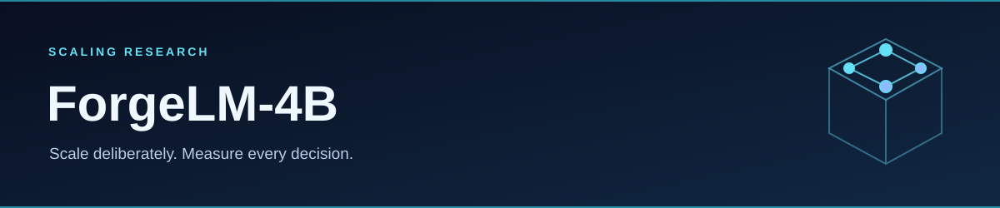

<div align="center">



### Scale deliberately. Measure every decision.

[Roadmap](docs/ROADMAP.md) · [Architecture](docs/ARCHITECTURE.md) · [Experiment registry](docs/EXPERIMENTS.md) · [Research log](docs/RESEARCH_LOG.md) · [Project website](https://anass19.github.io/ForgeLM-4B/)

</div>

---

## Overview

ForgeLM-4B is the proposed follow-on project for training and evaluating an approximately four-billion-parameter language model. It focuses on scaling decisions, distributed training, efficiency and reliability, grounded in evidence from the 1B-scale project.

**Status:** Planned after 1B milestone. **No completed 1B/4B training runs, released model weights, or benchmark results are claimed.**

## Engineering areas

- Scaling laws and compute budgeting
- Distributed and memory-efficient training
- Reliable restartable multi-GPU experiments
- Inference optimization and serving
- Model and system evaluation

## Milestones

| Stage | Milestone | Acceptance criterion | Status |
|---|---|---|---|
| 01 | Review ForgeLM-1B evidence | Analyze actual losses, training throughput, bottlenecks and evaluation results | Planned |
| 02 | Build a scaling plan | Parameter/token tradeoffs, context, optimizer, memory and compute budgets | Planned |
| 03 | Validate distributed training | Data or tensor parallelism as needed, checkpoint shards and fault recovery | Planned |
| 04 | Secure data and compute | Provenance, licensing, quality and feasible accelerator access | Planned |
| 05 | Train approximately 4B parameters | Document true parameter count, tokens, hardware, energy and run cost | Planned |
| 06 | Evaluate and optimize inference | Capability, latency, quantization, memory, robustness and model card | Planned |

## Repository layout

```text
ForgeLM-4B/
├── README.md                 Project overview
├── docs/
│   ├── index.html            GitHub Pages project website
│   ├── style.css             Responsive styling
│   ├── assets/               Minimal SVG brand assets
│   ├── ROADMAP.md            Milestone acceptance criteria
│   ├── ARCHITECTURE.md       Research design decisions
│   ├── EXPERIMENTS.md        Results and reproducibility registry
│   └── RESEARCH_LOG.md       Dated activity notes
├── src/                      Planned core implementations
├── data/                     Dataset documentation (no raw corpora)
├── configs/                  Future experiment configurations
├── tests/                    Future numerical/integration tests
├── evals/                    Future evaluation code
├── experiments/              Future experiment records
├── infra/                    Compute and deployment notes
├── scripts/                  Future entry points
└── .github/                  Issue and pull-request templates
```

*Directories with only README files describe intended structure, not completed software.*

## Research principles

1. Record precise assumptions, versioned configs, sources and datasets.
2. Separate proposed work, experiment runs, verified metrics and model releases.
3. Preserve validation evidence, reproducibility metadata, numerical checks and failures.
4. Report actual hardware use, training tokens, parameter counts and operating costs only after measurement.
5. Avoid publishing credentials, proprietary datasets or uncontrolled model artifacts.

## Project boundaries

The existing [ForgeAi](https://github.com/ANASS19/ForgeAi) repository is an **independent, unchanged practice workspace for sub-1B and first-principles exercises**. This project is a separate milestone. See the [ForgeAI roadmap](https://github.com/ANASS19/ForgeAI-Roadmap) for the broader program.

## Collaboration and license

Technical discussion and issues are welcome. A source/model license has not yet been selected; public source visibility alone does not grant reuse rights. Appropriate licenses will be chosen before sharing reusable implementations or weights.

---

Maintained by [ANASS19](https://github.com/ANASS19) · Forge AI research engineering.
